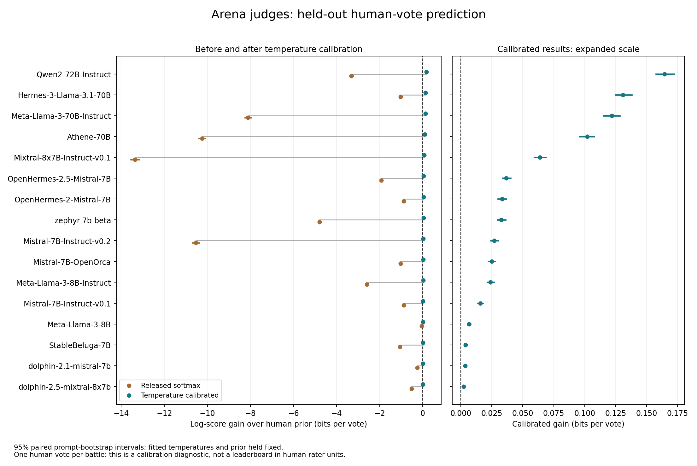

# Progress toward a leaderboard in human-rater units

**September 17 update:** a separate repeated-human dataset now supports a 16-configuration safety experiment. See [DICES results and the exploratory calibrated leaderboard](dices_validation_results.md). The Arena-specific limits below remain; the earlier statement about available releases describes the data inspected at that stage.

The intended leaderboard is sensible: rank AI judges by the smallest human panel whose expected score reaches the judge's score, using the same human population, items, scoring rule and human combiner. Fractional values come from interpolation. This is a performance equivalence under that protocol, not a universal claim that an AI replaces that many people. A common increasing benchmark curve generally preserves the ordering of scores; its benefit is the human-rater unit.

**The existing releases support a useful validation, but not yet a multi-judge leaderboard with positive human-equivalence values.** This continuation implements targeted mathematical corrections, adds a restricted paper protocol, and runs held-out calibration using the existing Arena predictions. No new human labels or AI inference were purchased or generated.

## Arena calibration results



[Vector graph](../benchmarks/results/arena-calibration/calibration_comparison.svg) · [Complete results and provenance](../benchmarks/results/arena-calibration/results.json) · [Table](../benchmarks/results/arena-calibration/leaderboard_diagnostic.csv)

We fitted one temperature per judge on **14,919 battles in 13,276 prompt groups**, then evaluated on **35,019 different battles in 30,980 disjoint prompt groups**. The split uses seed 1729 and 30% of prompt groups for calibration. All 16 previously verified judges use identical splits and 500 paired test-prompt bootstrap samples. Starling remains excluded for its previously unresolved source-baseline discrepancy.

**All 16 calibrated judges beat the calibration-set human-prior baseline on the held-out votes.** Each judge's 95% marginal bootstrap interval for the gain is above zero. The baseline score is −1.5835662 bits per vote. The leading measured gains are:

| Judge | Log-score gain over human prior | 95% paired interval |
| --- | ---: | ---: |
| Qwen2-72B-Instruct | 0.16455 bits/vote | 0.15767–0.17207 |
| Hermes-3-Llama-3.1-70B | 0.13074 | 0.12487–0.13805 |
| Meta-Llama-3-70B-Instruct | 0.12183 | 0.11529–0.12830 |
| Athene-70B | 0.10201 | 0.09562–0.10774 |

These are descriptive score rankings, not statistically established distinct places. The gains are measured log-score improvements, not proven mutual-information bounds.

This explains why the earlier zero-equivalence finding was too easy to misinterpret. The released uncalibrated forecasts were overconfident under log scoring. Temperature fitting substantially improves their held-out scores. The previous graphs remain valid for their explicitly uncalibrated, clipped forecasts on the full cohort; this is a separate experiment with different predictions, a test subset, no clipping, and a prior estimated from calibration labels only.

There is still only **one human vote per Arena battle**. Once a judge beats the zero-human prior, these data cannot locate its crossing with a one-, two- or larger-human predictor. The new result files therefore record `above_observed_range` and a null equivalence estimate, rather than fabricating a positive number. In particular, 0.16455 bits is **not** 0.16455 humans. Battles between the same two models cannot be pooled as repeated ratings when their prompts or responses differ.

### Calibration protocol and limits

Temperature scaling is a simple post-processing calibration method; it does not retrain the AI judge. We minimize calibration-set multinomial negative log likelihood over one nonnegative inverse temperature, beta, in [0,10]. The objective is convex in beta. Both endpoints and beta=1 are evaluated explicitly; beta=0 means a uniform forecast, with infinite temperature reported as null plus beta=0. No clipping is applied. A positive temperature preserves logit order; hard agreement is calculated using the release's original tie convention. [Temperature-scaling reference: Guo et al.](https://proceedings.mlr.press/v70/guo17a.html)

The constant human prior is estimated only from calibration labels. Test labels are used for evaluation and paired resampling, never temperature selection. Exact prompt duplicates remain in one split; near duplicates were not detected. This is a **retrospective** experiment because the aggregate dataset had already been inspected. The intervals hold fitted temperatures and the prior fixed; they omit calibration-fit uncertainty, voter/session dependence and multiplicity correction. A future confirmatory benchmark should freeze this protocol before collecting new evaluation votes.

Each calibrated judge's public anonymous CrossEntropy score was checked for exact equality against an independent ordered `math.log2` reduction. Analytic tests check the split and a multinomial example whose optimal inverse temperature is exactly 1/2. The split, bootstrap-schedule hash, source hashes, source-code hashes and dependency versions are saved with the results. Calibration is part of the evaluated judge configuration, so a future leaderboard must give every judge the same calibration opportunity.

## Mathematical repairs and restricted paper protocol

The complete regression suite now passes **122 test methods**. The new regressions first reproduced five failures and five errors before implementation changes. The preserved [before-fix record](../benchmarks/results/paper-protocol/regression-before.txt) and [current regression record](../benchmarks/results/paper-protocol/regression-tests.json) distinguish demonstrated bugs from new API requirements.

| Change | Why it is correct |
| --- | --- |
| Earliest `>=` equivalence crossing | A score on a plateau is attained at its start, not its end. Missing intervals cannot silently supply a crossing. |
| Zero-human boundary and explicit range statuses | A prior already reaching the AI score identifies equivalence zero. A score above the measured curve identifies a bound, not the largest measured panel as a point estimate. |
| Fixed-class binary AUC | ROC AUC ranks the probability of one fixed positive class; confidence in whichever class wins loses the direction of the prediction. |
| Named-label alignment in soft DMI | Reordering a probability vector's named labels must not change the joint matrix or its determinant. This does not resolve the separate expected-DMI estimand issue. |
| Bayesian external-training identity mapping | Exclude the matching training item, if present; an evaluation row's position is not a training item identifier. Separate arrays without identifiable row correspondence are rejected. |
| Explicit probability regularization | Combiners accept `extreme_cutoff=0`; the historical default remains .02. Negative/nonfinite/zero-mass vectors are rejected. Impossible observed events score −infinity under raw log scoring; zero-weight terms contribute zero. |
| Equivalence-table sample indices | Derived results retain their sample IDs instead of silently getting a new RangeIndex. |

`AnalysisPipeline(..., paper_mode=True)` is an **opt-in, restricted protocol**, not a certification that every public method strictly follows the paper. It requires a complete fixed-depth panel, built-in Bayesian combining, Agreement or log scoring, individual human references, and same-dataset item-level leave-one-out training. Unsupported human predictions fail explicitly instead of changing the evaluated cohort. Classifier predictions must cover that cohort. Missing scalar equivalences indicate an unidentified crossing; call `compute_one_equivalence_result` to distinguish bounds from undefined cases.

The mode sets the combiner's probability cutoff to zero. It cannot undo clipping already applied to classifier prediction objects; construct those with `extreme_cutoff=0` and handle their calibration explicitly.

For each k, it uses unique unordered predictor subsets paired with a disjoint individual reference. It takes the same number of subsets for every reference slot. Under a subset budget B and n human slots, each reference gets `min(comb(n-1,k), floor(B/n))` subsets. This is a **balanced stratified sampling variant**, not a literal reproduction of uniform sampling of 200 partitions. It makes the classifier and human benchmark use identical reference weights even under a cap. The budget must allow at least one partition per reference. Partitions and configuration survive save/load. The historical default sampler remains available; `max_K` remains exclusive.

The old scalar `compute_one_equivalence` retains its above-range cap for compatibility. Scientific reporting should use the structured method. `paper_mode` derived scalar tables use missing values for out-of-range estimates. Neither the mode nor the repaired boundary API makes the legacy summary/plotting classes a certified inference procedure; use explicit bootstrap-only intervals with censoring, as the supplied experiment runners do.

Two erroneous test expectations were corrected with independent justification: the old AUC example is 1, not .75, and a score below the k=0 baseline has identified equivalence zero. Tolerances were not loosened. Frozen numerical fixtures were not regenerated. Their historical AUC case explicitly replays its old confidence-ranking definition to test execution parity; corrected AUC additionally passes an independent positive/negative-pair enumeration through the pipeline. All other frozen fixture cases retain their existing exact comparisons.

## Repeated-human replay

The new protocol was replayed on the same **227 MT-Bench items, three external experts per item, and 500 question-cluster bootstrap samples**. The released GPT-4 judge remains approximately **0.94 human judgments**, with a **95% paired interval of 0.68–1.70**. One bootstrap crossing is above the measured two-human range and is retained as censored. [Full replay evidence](../benchmarks/results/paper-protocol/mt_check.json)

Checks include independent rational Bayesian draw probabilities (1e-14 tolerance for different arithmetic), exactly matching hard decisions and enumerated curve cells, exactly matching existing classifier-score cells, exact one/two-worker and memory-block parity, and exact save/load. The changed partition reduction order can differ from the old curve in final floating-point bits; this is a new protocol comparison, not a claim of bitwise equality to the old complement-averaging curve.

MT-Bench's human-vote exposure to GPT-4 feedback remains unresolved, so this is exploratory. Only one released AI judge is available on that repeated-human cohort. It cannot furnish a multi-judge leaderboard or transfer its equivalence estimate to Arena's population.

## What remains

The broad mathematical audit **still fails**: see the [current diagnostic summary](../benchmarks/results/paper-protocol/diagnostics/summary.json). Remaining findings include the expected-score contract for nonlinear DMI, anonymous Precision/correlation conventions, some input and execution contracts, undefined-pair reliability, ratio-table indices, and legacy confidence-interval plotting. These repairs do not certify those paths. No new performance claim is made for this work.

For the intended leaderboard, the next substantive requirement is repeated independent blinded human ratings on the **same Arena battles already judged by the AI models**, or additional AI judge outputs on a repeated-human dataset with established independent vote provenance. More independent people rating different battles would not solve the panel-curve requirement. A pilot could rate a fixed subset with six people per battle, allowing k=0 through 5 against a held-out human. Choose the final sample size from pilot precision, rather than treating that depth as a guarantee of adequate power.

Then use the same calibration protocol and human population for every judge, fit the human benchmark curve, calculate paired bootstrap crossings, and show a horizontal equivalence plot with intervals and explicit `>K` markers for unmeasured crossings. Show the underlying human power curve alongside it. Rank uncertainty and overlapping intervals should be visible. This is an Arena-style presentation in human-rater units; an Elo transformation is unnecessary.

## Historical experiment and current checks

```sh
.venv/bin/python -m unittest discover -s tests -p '*_tests.py' -v
# Still exits 1 while the broader documented findings remain:
.venv/bin/python benchmarks/run_correctness_audit.py --output-dir benchmarks/results/paper-protocol/diagnostics
```

The calibration and one-off paper replay scripts were retired during repository cleanup; their outputs and source manifests remain historical evidence. The local cleanup archive preserves their source. See [research tooling](../research/README.md) for maintained commands; the checks above require no model inference.
