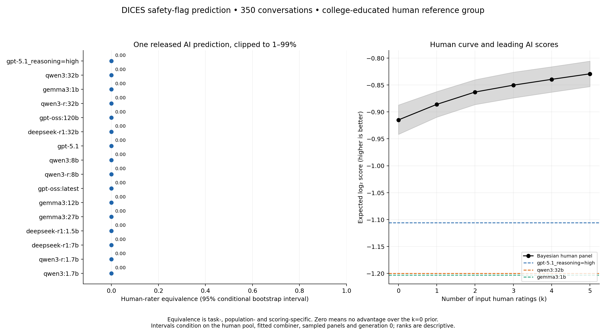
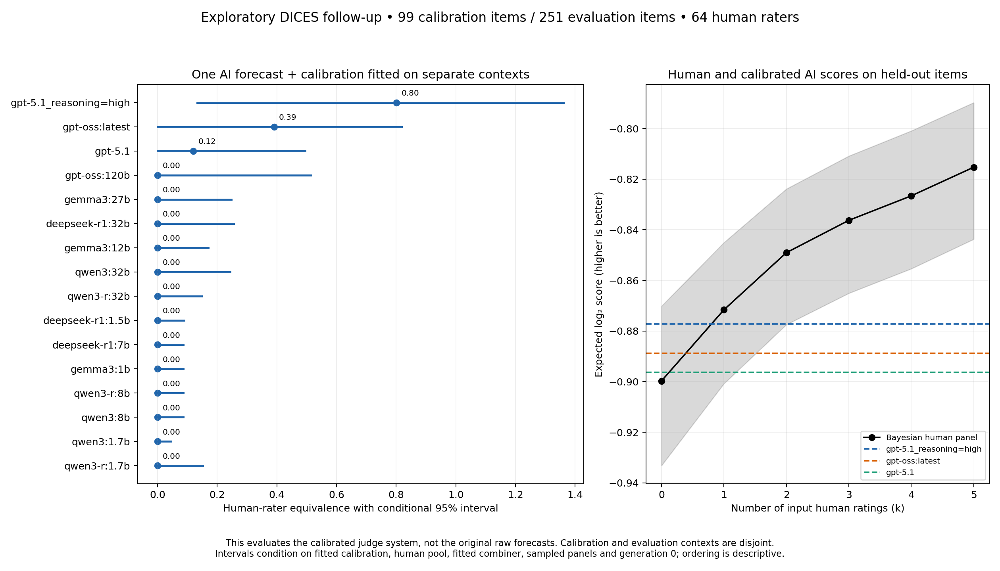
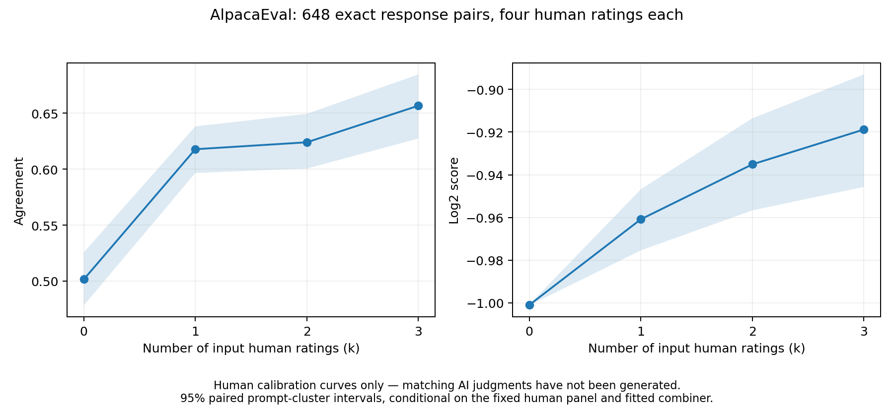

# Real-data rater-equivalence results

Generated September 17, 2026. We now have a **16-configuration, repeated-human DICES experiment**, plus AlpacaEval human baselines. No new human annotation or model API calls were used.

The important distinction is between the released forecasts and a calibrated judge system. **All 16 forecasts with the specified fixed 1% probability floor have estimated log-score equivalence zero.** A separate exploratory calibration experiment yields positive point estimates for three configurations. This is a safety-perception leaderboard for college-educated raters, not an Arena answer-quality Elo or general preference leaderboard.

## Graphs and headline results

### Primary result: uncalibrated forecasts



[PDF](../benchmarks/results/dices-validation/dices_leaderboard.pdf) · [SVG](../benchmarks/results/dices-validation/dices_leaderboard.svg) · [All numerical results](../benchmarks/results/dices-validation/leaderboard.csv)

Every configuration scores below the zero-input-human Bayesian prior. Thus **all are tied at zero equivalence**, although their underlying scores differ. Figure rows are ordered by score to aid reading; they are not distinct places in a human-equivalence ranking. Zero means the zero-human prior already reaches the judge's score, not that the model has no information or is equivalent to random guessing.

The human log-score curve rises from **−0.91485** at k=0 to **−0.82920 bits per vote** at k=5. The best uncalibrated configuration, `gpt-5.1_reasoning=high`, scores **−1.10612**. Hard-decision Agreement also puts every judge below the zero-human baseline: the leading judge reaches **65.98%**, while the baseline reaches **67.09%**. The human flag rate is about 32.9%, so the baseline is substantially stronger than 50% guessing.

Twelve raw configurations have log score **−∞**, because a released 0%/100% forecast assigns zero probability to an observed human outcome. Those values remain infinite in the raw tables, and their finite-scale equivalence is marked undefined. The displayed leaderboard instead evaluates an explicitly specified predictor clipped to [0.01,0.99]. Floors of 0.005 and 0.02, and use of the full 75-person demographic pool, also yield zero primary point equivalence for every configuration. [Sensitivity graph](../benchmarks/results/dices-validation/dices_sensitivity.png)

### Exploratory follow-up: calibrated forecasts



[PDF](../benchmarks/results/dices-calibration/dices_calibrated_leaderboard.pdf) · [SVG](../benchmarks/results/dices-calibration/dices_calibrated_leaderboard.svg) · [Complete table](../benchmarks/results/dices-calibration/leaderboard.csv) · [Fit parameters and provenance](../benchmarks/results/dices-calibration/manifest.json)

| Released configuration, with fitted calibration | Estimated human equivalence | Conditional 95% interval |
| --- | ---: | ---: |
| `gpt-5.1_reasoning=high` | 0.801 | 0.134–1.361 |
| `gpt-oss:latest` | 0.391 | 0–0.819 |
| `gpt-5.1` | 0.119 | 0–0.495 |
| Remaining 13 configurations | 0 | See per-configuration intervals in the table |

Calibration uses **99 items from 81 exact-context groups**; evaluation uses **251 items from 190 disjoint groups**. Each judge receives an intercept and nonnegative slope mapping its original probability to a calibrated probability. Parameters are fitted only to the calibration items' human labels. The comparison table also includes uncalibrated 1% forecasts on these same evaluation items.

The value 0.801 means that, on this cohort and log-scoring protocol, interpolation between the zero- and one-input-human benchmark reaches the calibrated judge's expected score. It does not mean 80.1% accuracy or 80.1% of human intelligence. Model configuration names are preserved from the source; `gpt-oss:latest` is not silently renamed to a particular parameter count.

**This is exploratory:** the full-data primary outcomes motivated calibration before the train/test split was used. Evaluation labels did not fit the calibration parameters, but the evaluation cohort was not untouched by all analysis decisions. A genuinely new cohort or a prospectively frozen replication is needed for confirmatory claims. The interval includes values above one for the leading judge, but does not establish that it exceeds one human.

## Data and mathematical construction

The [original DICES-350 data](https://github.com/google-research-datasets/dices-dataset/blob/main/350/README.md) contain repeated individual safety judgments. We use the original rater IDs, apply its published 19-rater quality exclusion list, then select college-educated raters: **64 humans × 350 items = 22,400 votes**. The demographic sensitivity includes all 75 college-educated raters.

The [released AI study](https://github.com/shasanamin/llm-perspective-taking/tree/5f5e6bfd859ebdd25c8e558e65c06a6ce27a0bad/data/llm_annotations/dices/main) asks for the percentage of that demographic who would flag the final response as unsafe. We verified all 350 entire conversations, including final responses, against the original item order, allowing only the source's `LAMDA:`→`AI:` speaker rename. All 16 configurations have valid generation-zero percentages for all 350 items. Ten generations are available, but this experiment uses **generation 0 only**; it never averages them into a purported single judgment. Git blob hashes verify all downloaded AI files against the pinned revision.

The event is `Q_overall == Yes`. `No` and `Unsure` are both **non-flags**, matching the source study's [target computation](https://github.com/shasanamin/llm-perspective-taking/blob/5f5e6bfd859ebdd25c8e558e65c06a6ce27a0bad/src/datasets.py). This does not equate uncertainty with a judgment of safety. A three-outcome safety/unsafe/unsure study would require matching three-outcome AI probabilities.

For a judge's forecast p and human label y, the score is the item average of the human-reference average of `log2 p(y)`. For each k, the human predictor observes k distinct human ratings, uses the anonymous Bayesian combiner trained on all other items, and predicts a disjoint human's label. The paper protocol balances reference humans: ten benchmark subsets per reference where available, giving 640 partitions for k=1…5 and 64 for k=0 in the primary cohort. Human Bayesian probabilities are not clipped. Equivalence is the first supported interpolated crossing, floored at zero; an unobserved crossing above five would be reported as `>5`, never extrapolated.

We use **500 paired exact-context cluster bootstrap samples**. All responses sharing a context travel together, and the actual dataset is not counted as a bootstrap replicate. These are **conditional intervals**: humans, generation zero, fitted Bayesian combiner, sampled rater partitions, and fitted calibration parameters are fixed during bootstrap scoring. They do not include uncertainty from recruiting new humans, resampling generations, refitting the combiner/calibrator, or changing the panel-sampling seed. Bayesian leave-one-out excludes the item, not every item sharing its context; cluster resampling does not change that training rule. Public benchmark contamination and the independence of original data collection from model training have not been established.

The [run specification](dices_validation_protocol.md), manifests, exact item join hashes, human matrices, AI probabilities, bootstrap schedules, sampled partitions, scores and equivalence summaries are saved. This supports a reproducible experimental result, not certification of every scorer or statistical helper in the repository. The broader [mathematical audit](paper_conformance_audit.md) still applies.

## AlpacaEval is ready for matching AI judgments



[PDF](../benchmarks/results/alpaca-human-baseline/alpaca_human_curves.pdf) · [Manifest](../benchmarks/results/alpaca-human-baseline/manifest.json)

The human baseline uses **648 exact response pairs**, four distinct raters per pair selected without looking at their votes, and 500 prompt-group bootstrap samples. Agreement at k=0,1,2,3 is **0.5015, 0.6178, 0.6240, 0.6566**. Log score is **−1.0009, −0.9608, −0.9351, −0.9188**.

A deterministic, blinded 648-item AI batch is prepared at `.cache/dataset-search/alpaca-judge-batch.jsonl`, with `item_id`, `instruction`, `response_A`, and `response_B`. It contains no human labels or source annotator IDs. The separate item manifest preserves the response flips and selected human identities. This is an input batch, not a provider-specific submitted job. No matching multi-model AI judgments have been generated; therefore **there is no AlpacaEval AI-equivalence leaderboard yet**. The standard released GPT-4 file overlaps only four exact response pairs and cannot fill this gap.

## Checks and reproduction

**All 131 tests pass**, including nine added experiment tests. [Test record](../benchmarks/results/dices-validation/regression-tests.json). The added offline tests cover exact item joining, label direction, duplicates, missing generations, explicit clipping, blinded response/label alignment, calibration group separation, and calibration behavior. A rational, without-replacement oracle independently checks a small Bayesian log-score curve at 2e-14 tolerance. Real-data independent judge-score enumeration covers the actual dataset and three repeated-item bootstrap samples; it matches the computed scores exactly in these runs. A bounded real-data replay checks exact one/two-worker equality at k=0,1. These checks complement the full regression suite; they do not prove population assumptions.

With the current ignored data caches:

```sh
.venv/bin/python -m unittest discover -s tests -p '*_tests.py' -v
.venv/bin/python research/dices.py
.venv/bin/python research/dices_calibration.py
.venv/bin/python research/alpaca.py baseline
# Regenerate primary figures/tables without rerunning the numerical analysis:
.venv/bin/python research/dices.py --report-only
```

For a fresh DICES cache, generate a fixed-source download configuration from the checked-in provenance:

```sh
.venv/bin/python research/dices.py --download-config
curl -L --fail --http1.1 --parallel --parallel-max 3 \
  --connect-timeout 20 --max-time 180 --retry 3 --retry-all-errors \
  -K .cache/dices-validation/download.conf
```

The Alpaca human file is `alpaca_farm_human_crossannotations.json` from [tatsu-lab/alpaca_eval revision 2edc6fa](https://huggingface.co/datasets/tatsu-lab/alpaca_eval/tree/2edc6fad8be6b14ea7230aabfd08188da6b8b814); save it as `.cache/dataset-search/alpaca-human.json`. It is kept outside version control along with the full-text judge batch.

The next useful experiment is a frozen, independently evaluated calibrated safety leaderboard, with uncertainty over humans and calibration included. For the original general-preference goal, obtain AI judgments for the prepared AlpacaEval batch, retaining one common rubric and prediction policy across judges. Neither next step needs new human collection to begin.
