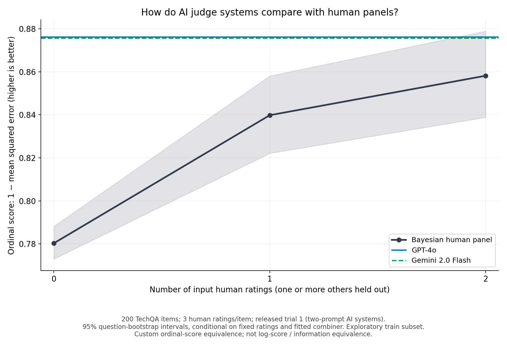

# Judge’s Verdict: ordinal judge-system equivalence

Generated September 21, 2026. This is an exploratory demonstration on **200 TechQA items with three human ratings each**, using released AI outputs. No new model inference or human annotation was performed.

## Graphs and finding

- [Human-panel comparison (PDF)](../benchmarks/results/judges-verdict/human_panel_comparison.pdf) · [PNG](../benchmarks/results/judges-verdict/human_panel_comparison.png)
- [Judge-system scores and equivalence bounds (PDF)](../benchmarks/results/judges-verdict/judge_system_equivalence.pdf) · [PNG](../benchmarks/results/judges-verdict/judge_system_equivalence.png)



| Predictor | Ordinal score | Supported empirical equivalence |
| --- | ---: | --- |
| No input humans: leave-one-item-out prior | 0.780327 | Baseline |
| Bayesian panel with 1 input human | 0.839814 | 1 |
| Bayesian panel with 2 input humans | 0.858151 | 2 |
| GPT-4o judge system | 0.876146 | Above the observed 0–2 range |
| Gemini 2.0 Flash judge system | 0.875625 | Above the observed 0–2 range |

Both AI systems exceed the observed two-human panel score. **We cannot estimate how many humans beyond two would match them.** Arrows marked “>2” denote an unobserved crossing, not an extrapolated point estimate or an assertion of equivalence to three humans.

The paired GPT-4o minus Gemini score difference is 0.000521, with a conditional 95% bootstrap interval of approximately **[−0.009168, 0.010214]**. These results do not establish a reliable ordering between the two systems. Both equivalences are censored at the upper end of the measured panel range; they cannot be ranked by their unknown exact equivalences.

## What this score measures

Humans assign quality ratings `0`, `0.5`, or `1`. The released AI `nv_accuracy` scores can also take `0.25` and `0.75`. These are ordinal quality scores, **not probability forecasts**.

We use the same utility for both sides:

\[
S(a,y)=1-(a-y)^2.
\]

Here `a` is the predicted quality and `y` is an individual human's rating. Thus a prediction of `0.25` against a human rating of `0.5` receives `0.9375`. A score of `0.876` is **not 87.6% classification accuracy**.

For the human panel, the existing anonymous Bayesian combiner estimates probabilities over the three rating categories, excluding the entire query item from its training frequencies. We turn that posterior into its expected numeric rating, which minimizes expected squared loss under that posterior. Probability clipping is disabled. Every possible input subset at k=0,1,2 is enumerated; scoring averages uniformly over the humans outside that subset. AI systems are scored against all three humans. Because all subsets are enumerated at fixed depth, each human receives equal reference weight on both sides.

This uses the repository's Bayesian combiner, analysis pipeline, bootstrap machinery, and supported-crossing calculation, with a small custom ordinal scorer. **It is not the restricted Agreement/log-score `paper_mode`, and it does not measure full-distribution or information equivalence.** Equal spacing between the ordinal categories is an explicit modeling assumption. No rounding of AI outputs, probability conversion, fitted calibration, or interpolation beyond k=2 was used.

## Coverage and uncertainty

- All 200 exact `(question, generated answer, reference answer)` tuples match uniquely for each inspected judge. There are 199 distinct question clusters.
- GPT-4o and Gemini have 200 finite scores each. Claude Sonnet 4 has six `NaN` scores and is excluded from the graphs; the full 200-item human cohort is retained. This corrects the earlier search-stage implication that matching IDs alone meant complete usable predictions.
- Only released **trial 1** is analyzed. Each AI output is a **two-prompt judge-system score**, not one model judgment. Trials are not averaged.
- There are 500 paired question-cluster bootstrap replicates, seed 1729. Intervals condition on the observed human ratings, fixed AI outputs, and already fitted leave-one-item-out combiner. They do not include model resampling, new annotators, or refitting uncertainty.
- GPT-4o exceeds the measured range in 498/500 replicates; Gemini does so in 496/500. Censored replicates are retained. Finite two-sided equivalence intervals are not identifiable.
- The paired score gain over the two-human panel has a conditional 95% interval of [0.003724, 0.033330] for GPT-4o and [0.002801, 0.031277] for Gemini.
- These are the public human-annotated **train** items, all from TechQA. This is not an untouched benchmark or evidence about general conversational preferences. The release alone cannot establish annotation independence, model exposure, or a universal human-rater unit.

## Validation and reproduction

The runner independently reconstructs every Bayesian posterior by enumerating ordered draws with integer counters and removing the query item's contribution. It checks **1,400 item/panel predictions**, every human-curve and AI-score cell in the original sample and 500 bootstrap replicates, and hand-calculated partial-credit examples. No unsupported predictions or missing human scores were found. Maximum posterior disagreement was 2.22e−16; maximum power-curve disagreement was 1.45e−15. Independent arithmetic is compared with absolute tolerance 2e−13; this does not alter any existing test tolerance or expectation.

A second seeded run reproduced both complete bootstrap score tables byte for byte. All 25 existing research tests passed. The core library suite was not rerun for this isolated plotting workflow.

Run from the repository root:

```sh
.venv/bin/python research/judges_verdict.py
```

The four downloaded source JSON files must be present in `.cache/dataset-search/september21/`; their pinned download URLs, filenames, and SHA-256 hashes are in [results.json](../benchmarks/results/judges-verdict/results.json). The output directory also contains the numeric ratings, item hashes, full bootstrap scores, and sample schedule. The runner makes no network requests. No library implementation or original tests were changed for this experiment.

Sources: [human annotation release](https://huggingface.co/datasets/nvidia/judges-verdict/blob/9936c2fc75ac7a093d1a7c42f7fe187226701aff/annotations_train.json), [released AI trials](https://huggingface.co/spaces/nvidia/judges-verdict/tree/92764ec7e3f742e022b122b32a6739c85da0ed20/benchmark/judge_results), [two-prompt scoring definition](https://docs.ragas.io/en/v0.3.4/references/metrics/).
