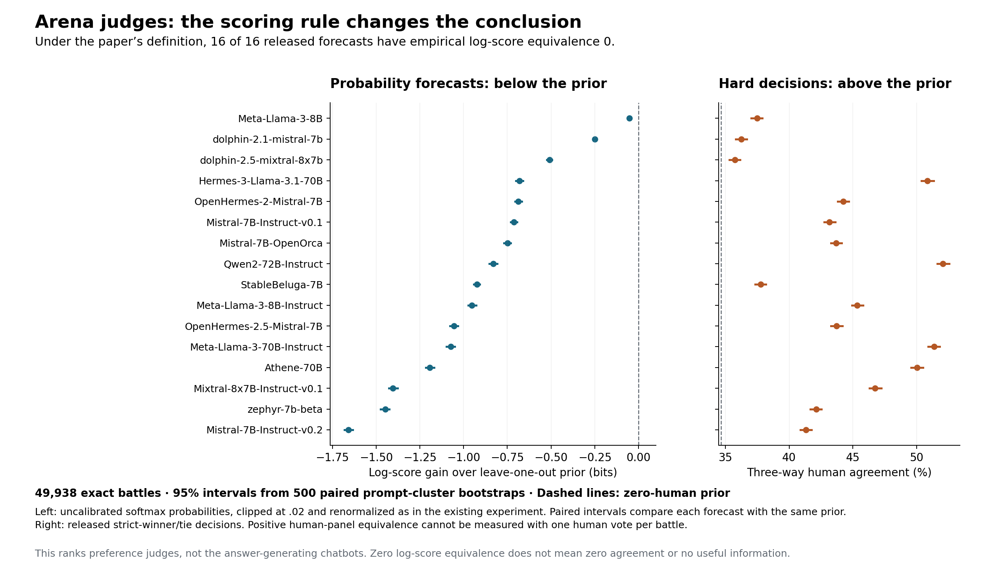
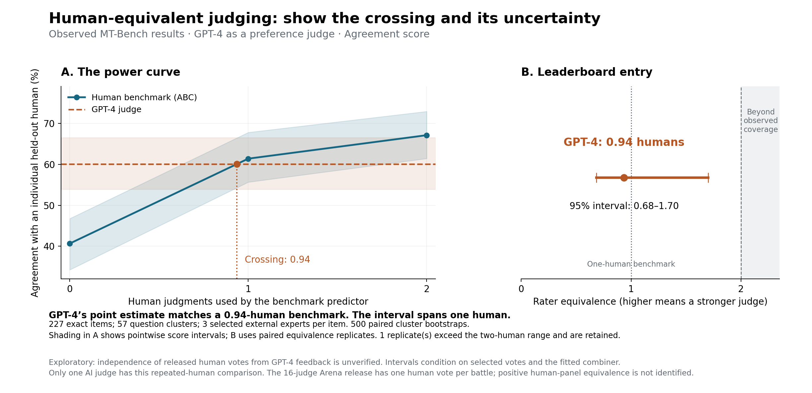

# Audit against the rater-equivalence paper

**Implementation follow-up:** the [paper-protocol repairs and real-data replay](arena_leaderboard_progress.md) address several findings below. This document preserves the original audit; the [new diagnostic run](../benchmarks/results/paper-protocol/diagnostics/summary.json) records current remaining failures.


**Verdict: the software implements the central framework, but it does not strictly implement every mechanism in the attached paper and cannot yet be certified mathematically correct across its supported inputs.** Some differences are deliberate extensions; others are confirmed defects. Exact agreement with historical software does not establish agreement with the paper.

Audited September 16, 2026 against runtime revision `39c80fc`, using **Principled Evaluation with Human Labels: One Rater at a Time and Rater Equivalence**, Paul Resnick, Yuqing Kong, Grant Schoenebeck, and Tim Weninger, **arXiv:2106.01254v3, April 22, 2026**, 60 pages. Page numbers below are printed/PDF page numbers. The supplied `rater.pdf` has SHA-256 `9e8ef1828a914882a497521e0768ad61f169dc817478166fe1d57526935568f3`.

This audit changes no production implementation, existing tests, tolerances, or historical numerical results. It adds independent diagnostics, evidence, corrected interpretation of the Arena zero boundary, and figures. It is a source-and-counterexample audit, not a formal proof of the whole program or a reproduction of every published case study.

## Evidence and reproducibility

- All **103 existing regression methods pass**, in 38.717 seconds: [test record](../benchmarks/results/paper-audit/regression-tests.json).
- All **four broader diagnostic groups still fail**: combiners/inputs, scoring, statistics, and execution. The previously fixed factorial-overflow cases pass; remaining findings are preserved in [fresh diagnostic evidence](../benchmarks/results/paper-audit/legacy-diagnostics/summary.json).
- The new paper-specific audit reproduces **12 deviations or extension-contract discrepancies**, with two passing controls. Several cases share a root cause; this is not a count of 12 independent bugs. [Cases, expected values, actual values, and source hashes](../benchmarks/results/paper-audit/conformance.json).
- The paper's worked sequence probability is reproduced exactly. The independently calculated leave-one-out posterior agrees to floating-point precision. Independent arithmetic uses a declared `2e-15` tolerance; existing exact-parity fixtures remain unchanged.
- New Arena calculations verify raw file hashes and reproduce the saved bootstrap schedule hash before comparing paired scores. [Zero-boundary evidence](../benchmarks/results/paper-audit/arena_zero_boundary.json).

```sh
.venv/bin/python -m unittest discover -s tests -p '*_tests.py' -v
# These two diagnostic commands intentionally exit 1 while findings remain:
.venv/bin/python benchmarks/run_correctness_audit.py --output-dir benchmarks/results/paper-audit/legacy-diagnostics
.venv/bin/python benchmarks/paper_conformance_audit.py
# Existing validated Arena files and ignored raw-data cache are required:
.venv/bin/python research/arena_baseline.py
.venv/bin/python research/arena_figures.py
```

## What the paper actually measures

There are two different uses of humans. A **benchmark panel** supplies labels to a combiner that predicts another human's judgment. An **evaluation rater** supplies the held-out label used to score that prediction and the AI prediction. Combining benchmark labels is central to the method. Combining evaluation labels by majority vote changes the subjective-utility target; the preferred evaluation size is one (pp.12–16).

For an item-separable log score, with higher scores better, the empirical classifier score is the item average of `log2 p_i(y)` averaged over the selected evaluation labels. Agreement substitutes `1[prediction_i = y]`. Nonseparable scores must be evaluated on complete prediction/reference vectors before averaging. Replacing them with scores of average sufficient statistics generally changes the finite-sample quantity.

For benchmark size `k`, average the human predictor's scores over valid benchmark/evaluation partitions to obtain `P(k)`. Interpolate linearly between integer sizes. The paper's Definitions 9 and 17 give

```text
REQ = min { x >= 0 : P(x) >= classifier_score }.
```

Consequences: use the first qualifying crossing, including equality; if the score is already at or below `P(0)`, equivalence is **exactly zero**; if it is above all measured powers, report **at least the largest supported size**, not a measured crossing. The theoretical infinite-domain definition allows infinity; finite empirical coverage does not identify infinity (p.21, Remark 18).

Rater equivalence is a score-specific comparison of predictive performance in human-panel units. It is not literal equality of distributions, a number of people who agree with a model, a claim that an AI vote is that many independent observations, or a measure of the quality of answers the model generates.

For ABC, write `m_l` for observed benchmark-label counts, `n_jl` for label counts on training item `j`, `k = sum_l m_l`, and `(a)_b = a(a-1)...(a-b+1)`. The algorithms calculate

```text
q_j(m)     = product_l (n_jl)_(m_l) / (n_j)_k
F_-i(m)    = mean_{j != i} q_j(m)
p_i(label) = F_-i(m + unit_vector(label)) / F_-i(m).
```

Impossible sequences have probability zero. On a complete matrix with at least `k+1` ratings per training item, summing the candidate numerators equals the denominator; the code's sum-and-normalize shortcut is mathematically valid. The current-item contribution and its count must both be removed. The paper's two-D/seven-C example yields `420/15120 = 1/36`, exactly as the code does. The empirical sequence estimate is unbiased under the paper's assumptions; the finite ratio is not thereby guaranteed to equal the unknown population posterior or maximize finite-sample scores. Optimality is an asymptotic statement. Zero empirical support is possible even if the population has full support, and requires an explicit finite-sample policy.

## Paper-to-code map

| Paper mechanism | Implementation | Audit result |
| --- | --- | --- |
| Independent items and independent labels conditional on item response state, pp.12,21 | Input matrix and sample schedules | Assumptions must be established from data; matrix shape cannot verify independence. Rectangular matrices are allowed by the paper. Unequal observed rating depth is an extension. |
| Individual evaluation labels, pp.14–16 | `Scorer.expected_score`, default reference size 1 | Agreement/log-score paths implement individual evaluation. `anonymous=False` averages actual column scores; `True` averages or samples item-local labels. They differ on sparse/nonseparable data. |
| Frequency and random-tie plurality, p.17 | `FrequencyCombiner`, `PluralityVote` | Positive-size frequency counts and plurality logic agree before probability clipping. Zero-rater priors are additional conventions. |
| Label-sequence probability, Algorithm 1, pp.45–46 | `probabilityOneItem`, `sumOfProbabilities`, `labelSeqProb` | Correct falling-factorial probability on supported fixed-depth data; worked example passes. Sparse eligible-row handling extends the algorithm. |
| Posterior with current item excluded, Algorithm 2, p.46 | `AnonymousBayesianCombiner.combine` | Correct same-dataset leave-one-out arithmetic before clipping; separate-training identity handling is unsafe. |
| Reuse full sums and subtract the held-out contribution, Appendix F | Prepared counts and deterministic caches | Directly supported by the paper's optimization argument. Ordered sums preserve historical arithmetic. |
| Up to 200 distinct `(benchmark, evaluation)` partitions, Definition 13 | `compute_power_curve` samples benchmark subsets and scores complements | Different finite estimator; duplicate unordered subsets and undersized samples are reproducible. |
| AI and benchmark use the same evaluation panels, Definition 16, p.29 | AI uses all experts; each benchmark uses its complement | Equivalent in balanced exhaustive dense separable cases, including the selected MT experiment. Not guaranteed with capped subsets or missingness. |
| Linear curve and earliest `>=` crossing, Definitions 15/17 | `PowerCurve.compute_one_equivalence` | Interpolation is correct for supported strict interior crossings. Plateau equality, missing gaps, and bound reporting fail. |
| Empirical domain through `k_w - k_e`, p.21 | `max_K` is exclusive; row-local reference cap | Valid same-population range for `k_e=1` when configured to include it. For larger requested evaluation panels, the cap changes the experiment rather than enforcing the paper's range. |
| 95% of 500 bootstrap item samples, Figs.5–7 | Summary classes and `Plot` | Original data row is included in bootstrap summaries; plotted endpoints can shift. New benchmark figures use separate reporting logic. The paper does not specify a full refitting/coverage protocol. |
| Numeric and nonlinear scorer extensions, pp.12,28–29 | AUC, Precision, F1, Correlation, DMI | Some direct metrics are correct, but AUC and other advertised paths have confirmed errors or mismatched estimators. DMI is not specified by this version of the paper. |
| Synthetic extrapolation, Appendix G | Synthetic examples/calibration utilities | Paper cautions against treating inferred synthetic panels as empirical evidence beyond observed depth. Not a solution to missing Arena human repeats. |

## Confirmed issues and proposed repairs

### 1. Fixed clipping changes the posterior and its optimality claim — high

[`DiscreteDistributionPrediction`](../surveyequivalence/combiners.py#L64) clamps each coordinate to `[.02,.98]` and renormalizes. Both Frequency and ABC always construct this object. A fully supported posterior `[.99,.01]` becomes `[.98,.02]`; a one-vote frequency vector `[1,0]` becomes `[.98,.02]`. In multiclass problems, normalization can bring coordinates below the nominal .02 floor.

Algorithm 2 returns the posterior itself. Its convergence/optimality claims do not hold unchanged for a fixed clipped transform when the true posterior lies outside those bounds. Full support means probabilities are positive, not at least .02. More data does not remove a fixed clipping threshold. Existing oracle tests deliberately include regularization and therefore validate the implemented variant, not the exact paper posterior.

**Repair:** separate raw posterior computation from explicit regularization. Provide a documented paper configuration and retain an explicitly named compatibility configuration for old results. Validate finite probabilities, vocabulary, normalization, and zero-probability scoring. A raw log scorer must define `log(0) = -infinity` and handle zero-weight terms deliberately; merely disabling clipping currently risks a math-domain error. If smoothing is wanted, document the changed estimator and analyze consistency, rather than claiming the paper's theorem without qualification. Measure clipping sensitivity on real data and recompute affected scores.

### 2. Equivalence inversion does not follow the minimum definition — high

[`compute_one_equivalence`](../surveyequivalence/equivalence.py#L312) looks for strict `>` rather than `>=`. For `{0:.2, 1:.5, 2:.5, 3:.8}` and score `.5`, it returns **2 instead of 1**. A missing crossing can produce a fabricated zero. An above-range score returns the final size as an ordinary number, losing the lower-bound interpretation.

The newer [`supported_equivalence`](../research/arena.py#L129) handles several of those problems, but has another boundary error: with `{0:.2, 1:.5}` and score `.1`, it reports lower censoring at 0 instead of **identified equivalence 0**. This does not affect the existing MT point estimate or its saved replicates. It does matter for interpreting Arena.

**Repair:** one shared, independently tested result API for point estimates, lower/upper bounds, missing support, and reasons. Start at zero, scan ordered segments, return the earliest equality/crossing, and preserve missingness. When `min_k>0`, distinguish unsupported lower sizes from an identified zero. Preserve sample identities. Test plateaus, descending segments, equality, empty/gapped curves, and both boundaries. Do not enforce monotonicity silently; it changes the empirical curve.

### 3. Shared evaluation panels are not guaranteed — high

[`compute_classifier_scores`](../surveyequivalence/equivalence.py#L779) scores AI predictions against every expert. [`compute_power_curve`](../surveyequivalence/equivalence.py#L1020) removes the selected benchmark columns first.

With two identical rows `[a,b,b]`, fix the benchmark to column 0 and let both that benchmark predictor and the AI always predict `a`. The benchmark scores **0** against held-out columns 1/2, whereas the AI scores **1/3** against all three columns. The predictions are identical; only the evaluation weights differ. This violates the finite shared-partition comparison in Definition 16.

Full enumeration with dense data and separable scores balances these weights, which is why the MT experiment avoids this counterexample. Averaging more bootstrap samples does not automatically balance a fixed, restricted rater-subset schedule.

**Repair:** generate and persist explicit disjoint benchmark/evaluation schedules, with common evaluation panels across methods and survey sizes. Score the AI on the same weighted item/evaluation observations. Keep a common evaluation schedule while varying benchmark subsets, or report partition-specific AI comparisons explicitly. Check prediction support with a joint mask and publish effective item/reference counts; otherwise unsupported human predictions can select a different population from AI scoring.

### 4. Partition sampling differs from the paper — medium/high

The paper samples set-valued `(b,e)` partitions without duplicates, with cap 200. The code caps benchmark subsets and averages complement scores, which can be a reasonable variance-reduction alternative but is not literally that finite algorithm.

There are also two concrete sampler issues at [`equivalence.py:827`](../surveyequivalence/equivalence.py#L827): the moderate-size branch samples indices with replacement and then deduplicates; the large branch considers different orders of the same subset distinct. Fixed examples produce **3 distinct sets instead of 4**, and **2 distinct sets in 3 ordered tuples**. These change effective budget, dependence, and realized partition weights. They do not by themselves prove bias in every population expectation.

Separately, binary multi-rater reference formulas sample without replacement, but the multiclass fallback samples with replacement. For `[a,a,b,c]` and three evaluation raters, `P(plurality=a)` is **2/3** for distinct-rater subsets versus **9/16** for the implemented replacement sampler.

**Repair:** define one explicit partition/sampling contract, canonicalize subset identities, sample distinct sets without replacement when required, preserve uniform tie rules, and test finite distributions by enumeration. For the paper's subjective evaluation, use `k_e=1`, which also avoids the majority-panel target change.

### 5. Separate training data are excluded by the wrong identity — high for that mode

When ABC has constructor-bound training data, the pipeline retains that matrix but still passes the evaluation row position as `item_id` ([preparation](../surveyequivalence/equivalence.py#L928), [prediction call](../surveyequivalence/equivalence.py#L1009)). With disjoint training items `[a,a]` and `[b,b]`, the correct zero-label prediction for a new item is `[.5,.5]`. Passing evaluation position 0 instead excludes the unrelated first training item and produces `[.02,.98]`. Three evaluation items and two training items also cause an out-of-bounds error on the third prediction.

The standalone ABC method documents positional exclusion; the problem is pipeline identity mapping when its training/evaluation datasets differ. The paper uses the same dataset with the current item removed.

**Repair:** require identical item identity/order for the paper's leave-one-out mode, or add an explicit training/evaluation identity map. Disjoint held-out items exclude nothing; overlapping items exclude their matched training observations. For prompt-cluster cross-fitting, remove the whole held-out group and label that protocol as an extension. Never infer identity from position across different datasets.

### 6. Sparse ratings require an explicit statistical target — high for interpretation

The paper permits any rectangular `n × k_w` matrix; it does not require a square matrix. Its empirical definitions use the same observed rating count per item. Filtering missing cells is necessary engineering support, but does not prove the same estimand or consistency for informative missingness.

For rows `[a,a,a]` and `[b,missing,missing]`, an always-`a` classifier scores **.5** under equal item weights but **5/6** when averaging observed-column scores. The default non-anonymous path produces the latter. ABC's zero-label prior averages item frequencies, while Frequency pools observed votes; their priors also differ with unequal depths.

At nominal benchmark size `k`, missing selected ratings can leave an item with fewer than `k` actual labels; the horizontal axis is then selected columns, not uniformly `k` human judgments. ABC also restricts its training rows to those supporting the queried sequence length. Eligibility can change with `k`. The previously agreed row-local evaluation-size cap is a useful extension, but changes `k_e` and is not the paper's fixed-size experiment. The default maximum range remains exclusive and is not adjusted to preserve a larger fixed `k_e`.

**Repair:** offer a fixed-depth paper protocol that selects an eligible cohort once, randomly samples a declared number of independent labels per item, and retains the same population across `k`. Keep the sparse protocol separately documented with actual per-item panel sizes, missingness/support diagnostics, weighting rules, and assumptions. Do not discard scarce labels automatically outside the explicitly chosen fixed-depth protocol. For disjoint human populations, define which population trains the prior; the current shared matrix can mix expert and amateur labels.

### 7. Additional scoring defects remain — high

The [fresh scorer diagnostics](../benchmarks/results/paper-audit/legacy-diagnostics/scorers.json) reconfirm:

| Path | Counterexample | Required action |
| --- | --- | --- |
| Binary AUC | Perfect fixed-positive-class ranking returns **.5 instead of 1** because `.value_prob` is confidence in whichever class wins | Use the same named positive class for every prediction; define unsupported/single-class behavior. |
| Soft DMI | Reordering one prediction's label coordinates changes a determinant score **.15 to 0** | Align probability coordinates by label before matrix accumulation. |
| Anonymous DMI | Computes `abs(det(E[J]))`, not `E[abs(det(J))]`; tiny hard example **0 vs .125** | Name the target. The paper's finite expected-utility definition requires averaging full-vector scores if DMI is offered as that score. A population plug-in target is a different estimator. |
| Precision | Deterministic one-reference case returns **1 anonymously vs .5 directly** | Carry identical averaging/positive-label conventions through every path. |
| Anonymous Correlation | The sole possible reference equals predictions, but raises `NotImplementedError` | Implement complete-vector correlation with numeric reference means, or reject the unsupported mode clearly. |

Direct F1/confusion-count/Pearson checks in their tested configurations pass. That does not repair the above paths. DMI is an extra library feature, not a formula established by this paper. The paper includes AUC figures, but this audit has not reproduced those figures with corrected AUC; matching their historical software outputs would not independently validate the metric.

### 8. Uncertainty, plots, and result integrity need repairs

The paper shows bootstrap error bars but does not provide a complete bootstrap-refitting specification or guarantee interval coverage. The library includes the actual-data row in bootstrap means/standard deviations/quantiles, chooses an interval method by total rather than valid replicate count, and can draw interval endpoints shifted from their stored values. Undefined reliability comparisons count as losses; derived tables can lose sample IDs. [Fresh statistics evidence](../benchmarks/results/paper-audit/legacy-diagnostics/statistics.json).

Predictions are fitted once and reused across item bootstraps. This implements uncertainty conditional on fitted predictions/subset choices, not a bootstrap that refits the ABC prior, judge calibration, and sample design each time. The Arena figures correctly identify that conditioning, resample question clusters, exclude the original point from percentile intervals, and retain censored equivalence replicates. They do not establish full unconditional confidence coverage. A 95% interval is not a posterior probability or proof that two overlapping/non-overlapping marginal intervals imply a particular paired rank test.

**Repair:** separate point estimates from bootstrap replicates; use paired valid masks; preserve censoring and sample identifiers; draw absolute interval segments independently from markers. Define conditional and refitted/group-cross-fitted uncertainty modes and test coverage on controlled cases before calling the latter comprehensive. Remove all copies of a held-out item/group from its training fold when repeated bootstrap identities occur. Keep paired score differences, not just separate marginal error bars, for comparing judges.

The older audit also reproduces raw numeric-label coercion, rerun classifier misalignment, shallow prediction snapshots, typed-output save/load loss, and global-RNG/blocking differences without explicit `random_state`. These are not equations in the paper, but can invalidate analyses implementing it. See [execution evidence](../benchmarks/results/paper-audit/legacy-diagnostics/execution.json) and [input evidence](../benchmarks/results/paper-audit/legacy-diagnostics/combiners.json).

## Internal paper inconsistencies: do not encode these literally

The attachment itself needs interpretation. These observations were checked against rendered equations, not just PDF text extraction.

1. **Claim 12, p.19, reverses its inequality.** Its displayed `REQ_alternative <= REQ_calibrated` contradicts its title, Claim 11, Definition 9, and the following proof. A pointwise higher power curve reaches a fixed score no later, so the intended inequality is `REQ_calibrated <= REQ_alternative`.
2. **Cross-entropy sign.** Page 12 defines positive cross-entropy loss, but later maximizes scores. The coherent score is negative cross-entropy, i.e. mean log probability. The library's `CrossEntropyScore` follows that direction. Base-2 logs make units bits; changing the log base by a positive factor does not change equivalence when applied consistently to both sides.
3. **Calibration is weaker than being the full posterior.** Definition 10's `E[Y | c(Z)] = c(Z)` is also satisfied by an uninformative constant base-rate predictor. With equally likely states `.1/.9`, that predictor has expected log score `-1` bit, while the full posterior achieves approximately `-.469` bits. The optimality argument is for the intended `E[Y | benchmark labels]` combiner, not every calibrated classifier.
4. **Mean squared error is not linear in the evaluation label.** The discussion on p.28 claims equality between loss against a panel mean and average loss. Predicting `.5` for labels `0,1` gives loss **0 against their mean**, versus average squared loss **.25**. Their difference is the label variance. It may cancel in some relative comparisons, but the absolute equality is false.
5. **Fractional panel interpretation needs separability.** Definition 7's linear interpolation is a valid definition. Interpreting it as using `k+1` humans on some individual items and `k` on others is justified directly for Agreement/log score, but not generally for nonlinear F1/AUC/correlation. For balanced binary labels, mixing always-positive and always-negative classifiers independently per item at 50% gives asymptotic binary F1 `.5`, while interpolating their F1 scores gives `(2/3 + 0)/2 = 1/3`. A randomized whole-dataset policy has the linear expected-score interpretation.
6. **Appendix notation contains slips.** Algorithm 1 returns `tot` although it accumulates `sumprob`; the intended item average is clear. Appendix F's simplification of the combinatorial factor omits the subtraction in the factorial denominator: `choose(n,m)*m! = n!/(n-m)!`. The implemented falling factorial is correct. Finite-sample bias/monotonicity discussion should not be promoted to a guarantee for every combiner, metric, or sparse dataset.

These issues do not invalidate the useful core definition or the posterior-scoring argument. They do mean that strict conformity should be pinned to a written mathematical contract resolving the ambiguities, rather than literal reproduction of every sentence.

## Arena: a correction to the previous conclusion

**The earlier blanket statement that one vote makes every equivalence unidentifiable was too broad.** With one observed human vote per battle, we can still estimate the zero-human prior from other battles. If it already beats the classifier, Definition 17 identifies empirical equivalence as zero. What is missing is the curve needed to quantify **positive** equivalence.

On the existing 49,938 matched battles, the ABC leave-one-item-out baseline is **−1.5836467 bits**. Every one of the 16 verified judges' previously reported, uncalibrated and clipped probability forecasts scores below it. Each has **empirical log-score equivalence 0**, and all 500 paired bootstrap comparisons stay below the baseline for every judge. The strongest released log score, base Meta-Llama-3-8B, is approximately −1.6357 bits. All 16 **unclipped** softmax point scores also fall below the prior; the zero-boundary finding is not caused solely by the clipping rule. Clipping activates on between 0 and 49,845 of 49,938 rows, depending on judge, so its numerical effects are substantial for some forecasts. [Full evidence](../benchmarks/results/paper-audit/arena_zero_boundary.json).

This does **not** say these models have no information about human preferences. Bad probability calibration can make their log score worse than a prior despite useful hard decisions. It also does not establish a population equivalence of exactly zero with no uncertainty: the reported boundary and bootstrap results are empirical, conditional on the given predictors, cohort, and sampling protocol.

All 16 hard-decision agreement scores exceed the zero-human hard prior, **34.667%**. Their positive Agreement equivalences remain unmeasured because there is no independently held-out human benchmark rating on each battle. The same models can therefore have identified zero log-score equivalence and unmeasured positive Agreement equivalence. Those are different questions, not a contradiction.



[Vector figure](../benchmarks/results/paper-audit/arena_paper_scorecard.svg). The historical Arena JSON files retain their original status strings as run evidence; this audit supersedes their blanket identifiability interpretation.

The repeated-human MT-Bench result remains an **exploratory Agreement equivalence of 0.94 humans, 95% paired percentile interval 0.68–1.70**, on 227 items/57 question clusters with three selected external experts. Its paired AI-minus-one-human Agreement difference is **−1.32 percentage points**, with interval **−6.97 to +4.01 points**. The evidence does not establish a clear advantage or disadvantage relative to one human. Only one released AI judge is represented, and the provenance of human votes relative to GPT-4 feedback remains unresolved.



[Vector figure](../benchmarks/results/paper-audit/rater_equivalence_paper_view.svg), [figure provenance and paired difference](../benchmarks/results/paper-audit/figure_provenance.json). The graph replots existing scores; it does not manufacture new labels or repair the underlying runtime.

## Recommended Arena-style leaderboard

Use the Arena presentation style with **AI judges as entries and human-panel equivalence as the unit**. The title should name the human population, task, score, and dataset version. Elo/Bradley–Terry ratings of answer-generating chatbots answer a separate question. Fitting Elo to judge-vs-judge score differences is unnecessary for this paper's statistic and does not turn those ratings into human equivalents.

For a defensible distribution-focused leaderboard:

1. Select a common, representative set of exact prompt/response pairs. Use the same human population, label definitions, tie policy, and scoring cohort for every judge. Retain ties as a declared third category rather than silently removing disagreement.
2. Obtain independent, blinded human ratings on the **same exact items**. To measure benchmark panels through `K` against one held-out human, collect at least `K+1` usable ratings per evaluation item. Determine item count with a pilot studying curve slope and interval width; there is no universal sufficient item count. A model-matchup identity alone is not an item identity.
3. Collect each AI judge's probability forecast for those labels. Distinguish verdict-token probabilities from probabilities of a random human vote. Fit any temperature/vector/isotonic calibration on disjoint prompt groups, keep the final test groups untouched, and publish raw and calibrated scores. Hard-only outputs can be evaluated with Agreement; invented soft probabilities are not equivalent evidence.
4. Use ABC with the posterior/regularization contract explicitly stated. Choose individual evaluation labels (`k_e=1`), and use shared benchmark/evaluation schedules with a fixed cohort across `k`. The primary distributional score should be mean log2 probability; Agreement is a separately labeled secondary result. Calibration metrics and subgroup scores provide diagnostics, not substitutes for the primary estimand.
5. Estimate the empirical power curve and apply the exact minimum definition. Report `0` at the baseline, an interpolated point inside the range, a bound such as `>= K` above coverage, and unavailable where support fails. Do not extrapolate a fitted curve beyond observed human depth merely to produce a leaderboard number.
6. Use paired resampling across judges and the human benchmark, respecting prompt clusters and other known dependence. State whether calibration/prior fitting and human-panel selection are conditioned on or refitted. Report paired differences/rank uncertainty; do not use arbitrary tie-breaking to imply meaningful ordering between statistically unresolved judges.

The main display should be a **dot-and-interval leaderboard in human units**, with arrows for bounds and an explicit marker for zero. Beside it, show the shared **power curve with horizontal judge-score lines and their crossings**, following Figure 3. For log scoring, centering at `P(0)` yields information gain in bits like Figures 5/7; subtract the same baseline from both benchmark and AI. Show support depth and the censored/missing bootstrap fraction. Flat power curves explain why narrow score intervals can yield wide equivalence intervals.

Suggested table columns: judge/version, raw or calibrated, score gain over prior, rater equivalence with status/interval, Agreement, item count, human depth, supported/censored replicate counts, and benchmark version. Use common baselines and data across entries; equivalence numbers from different populations or scores are not directly comparable. A shared increasing curve mostly preserves score ordering while adding human-effort interpretation. It can also collapse several distinct scores to zero or to the same unmeasured bound, as these Arena data illustrate.

If the assignment instead requires ranking **answer generators**, keep their preference-quality leaderboard separate. Rater equivalence can validate the judging system used to produce that leaderboard. A whole-ranking equivalence experiment would require a new, explicit ranking-fidelity score, repeated human votes, common comparison graphs, and resampling/refitting the ranking model. That extension is not implemented or proved in this paper. Do not count an AI with equivalence `r` as `r` independent human votes in an Elo fit.

## Repair and release order

1. **Resolve the mathematical contract:** higher-is-better log score, raw versus regularized posterior, individual evaluation, distinct partitions, common evaluation weights, exact boundary/bound semantics, and sparse versus fixed-depth protocols. Version this contract with the paper and documented errata.
2. **Fix numerical/result errors with failing-then-passing regressions:** AUC class probability, DMI label coordinates, crossings/zero/bounds, plotted endpoints and valid paired comparisons, input/index identities, separate-training holdout, and persistence types. Promote the corresponding diagnostics into required tests.
3. **Implement the chosen finite estimators:** partition sampling, shared schedules/support masks, Precision/DMI contracts, and supported numeric scoring. Preserve a deliberate compatibility path where correcting the statistic changes historical results; do not weaken old assertions to hide a changed target.
4. **Validate the complete research path:** regular and independent diagnostic gates green, exact parity on unaffected cases, independent enumerations/rational checks on corrected cases, seeded worker/block/save-load parity, and end-to-end protocol tests. Reproduce the paper's case studies with pinned data and independently correct metrics before claiming reproduction of published numerical values.
5. **Finish the real Arena study:** add repeated blinded human labels, evaluate calibration on held-out groups, audit leakage/provenance, and rerun the leaderboard with proper uncertainty. Existing released logits alone cannot create the missing human-panel curve. Until then, publish the zero-boundary probability result, direct Agreement comparison, and clearly exploratory single-judge MT result.
6. **Then optimize further:** retain the existing CPU caching/preparation improvements that match Appendix F, benchmark against the newly corrected reference, and investigate memory/worker costs. GPU work is not a remedy for any finding here and remains secondary to mathematical validity.

The audit and figures are complete. Production repairs, a paper-conformance mode, calibration experiments, new human annotation, full uncertainty validation, and reproduction of the paper's three historical case studies remain to be done.
