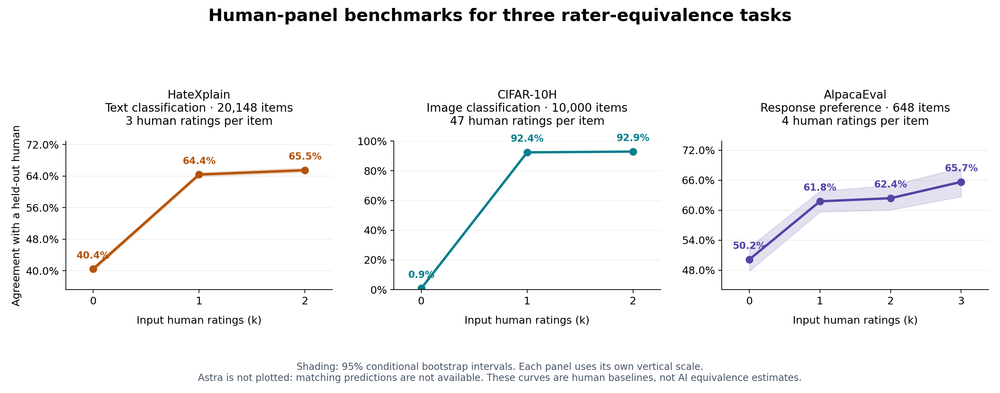

# Rater-equivalence research briefing

Prepared September 20, 2026, for the September 21 discussion. This summarizes
the saved investigations; it does not introduce new experimental results.

**Opening statement:** “I am building an Arena-style leaderboard of AI judges,
where the rating is the number of human judgments needed by a specified human
benchmark to match one AI forecast's expected score. We now have a working
repeated-human demonstration, a multi-judge safety experiment, and a general
preference dataset ready for AI evaluation. The main findings are that
calibration matters, repeated ratings are essential, and the rating depends on
the task, human population, scoring rule, and human combiner.”

For a short meeting, show **MT-Bench → DICES before calibration → DICES after
calibration → AlpacaEval**, then discuss the next experiment. Keep the two Arena
figures and the candidate-dataset comparison as supporting material. All seven
figures appear in the [PDF graph briefing](../output/pdf/rater_equivalence_research_briefing.pdf).

## How to explain the measurement

For each item, a human benchmark sees k human labels and predicts a separate
held-out human's label. The AI sees the task content and supplies its own
prediction. We score both against the same human-reference distribution.
The human power curve P(k) is its expected score. Rater equivalence is the
earliest point where its interpolated curve reaches the AI's score.

- **Agreement** evaluates the hard decision; **log score** evaluates the entire
  forecast and penalizes confidently predicting an outcome humans do not choose.
  Higher is better for both; the implementation's log score is negative
  cross-entropy, measured in bits.
- **k=0 is an estimated prior**, not necessarily random guessing. Zero
  equivalence means that prior already matches or exceeds the AI score.
- A result of 0.8 means an interpolated human benchmark matches the score. It
  does not mean 80% accuracy, 80% human intelligence, or literal equality of the
  underlying probability distributions.
- Scores above the measured range receive a bound such as **>3**, not an
  extrapolated point estimate. Different tasks' human units are not comparable.

## 1. MT-Bench: a working example of the intended visualization

**Question:** Can a real AI judgment be placed on a measured human power curve?

**Data and result:** 227 exact items, three selected expert votes per item,
57 question clusters, and released GPT-4 hard judgments. GPT-4 agrees with the
human reference about **60.06%** of the time. Its Agreement equivalence is
**0.94 human judgments**, with a conditional 95% bootstrap interval of
**0.68–1.70**. One of 500 bootstrap crossings exceeds the measured two-human
range; it is retained as censored, not discarded. The restricted paper-protocol
replay independently reproduces the estimate.

**Say:** “The left panel explains the number: follow the AI score horizontally
to the human curve. The right panel is the corresponding leaderboard entry.”

**Qualification:** The interval spans one human. We cannot claim GPT-4 is
better or worse than one human with this result. The original annotation
procedure involved GPT-4 feedback, and independence of the released votes from
that feedback is unresolved. This is an exploratory demonstration with one AI
judge, not the final multi-judge leaderboard.

The often quoted roughly 80% human–AI agreement is not a universal target:
our reproduction of the published MT-Bench expert comparison is roughly 66%
including ties and 85% among decisive comparisons. Different cohorts, tie
rules, and weighting produce different numbers.

[Replay and exact checks](../benchmarks/results/paper-protocol/mt_check.json).

## 2. Chatbot Arena: the identifiability and calibration investigations

**Question:** Can the existing Arena human/AI releases directly produce the
desired leaderboard?

We joined **49,938 exact single-turn battles** to **16 AI judges**, but there is
only **one human vote per battle**. In the original uncalibrated forecast
analysis, every judge's log score is below the leave-one-out prior
(approximately −1.58365 bits), giving empirical **log-score equivalence zero**.
Every judge's hard agreement exceeds the hard prior (34.667%). These different
score-dependent findings are compatible.

**Correction to our earlier interpretation:** one human vote does not prevent
identifying the zero boundary. It prevents measuring the positive human-panel
curve needed once a judge beats that boundary. Different conversations involving
the same model pair cannot be pooled as repeated ratings of one item.

We then fitted a separate temperature per judge on **14,919 battles** and
evaluated on **35,019 battles**, keeping exact prompt groups disjoint. All
16 calibrated forecasts beat the training-fitted prior on the evaluation set.
The largest estimated gain is **0.16455 bits**, for `Qwen2-72B-Instruct`.
That is a score improvement, **not 0.16455 humans**: positive equivalence remains
unmeasured because the second human vote is absent.

**Say:** “Arena shows why raw accuracy is insufficient and why calibration
must be part of the judge specification. It also shows why we needed a
repeated-human dataset.”

**Qualification:** This was retrospective analysis; temperatures and the prior
are fixed in the reported bootstrap intervals. The before/after experiment uses
a different evaluation subset and prior from the first full-data graph.

[Calibration results](../benchmarks/results/arena-calibration/results.json) ·
[Boundary evidence](../benchmarks/results/paper-audit/arena_zero_boundary.json).

## 3. DICES: the first repeated-human, multi-judge experiment

**Question:** What happens when enough repeated human votes and matching AI
forecasts are already available?

We verified **350 conversations × 64 quality-filtered, college-educated raters
= 22,400 human votes**, alongside **16 released AI configurations** on the same
conversations. Each configuration uses one released generation per item.
The event is whether a human flags the response as unsafe; “No” and “Unsure”
both mean non-flag, not proven safety. We measured panels through k=5.

For the specified **1% probability-floor variant**, all 16 configurations have
estimated log-score equivalence **zero**. The best AI log score is approximately
−1.10612, below the prior at −0.91485. The human curve improves to −0.82920 at
k=5. All configurations also fall below the hard-agreement prior: best AI
65.98%, prior 67.09%.

**Say:** “This is a valid multi-judge result, even though every equivalence is
zero. Their forecast scores differ, but their equivalence ranks are tied.”

**Sensitivity:** Twelve unmodified configurations have negative-infinite log
score because they predict zero probability for an observed outcome. The graph
explicitly uses forecasts clipped to 1–99%; it is not their raw log-score
leaderboard. Floors of 0.5% and 2%, and the full 75-person demographic pool,
still produce zero point equivalence for all judges. See the optional
[sensitivity graph](../benchmarks/results/dices-validation/dices_sensitivity.png).

## 4. DICES calibration: positive estimates, with limited claims

We fitted calibration on **99 items / 81 context groups** and evaluated on
**251 items / 190 disjoint groups**. The same held-out cohort supplies both the
human benchmark and AI evaluation. These numbers rate the **judge plus fitted
calibration**, not the original forecast alone.

| Released configuration + calibration | Human equivalence | Conditional 95% interval |
| --- | ---: | ---: |
| `gpt-5.1_reasoning=high` | 0.801 | 0.134–1.361 |
| `gpt-oss:latest` | 0.391 | 0–0.819 |
| `gpt-5.1` | 0.119 | 0–0.495 |
| Other 13 configurations | 0 | Individual intervals in the saved table |

**Say:** “Once calibrated, three systems have positive point estimates. The
leading system matches roughly a 0.8-human benchmark on this safety task.”

**Qualification:** Do not claim the leading judge exceeds one human or that
the ordering is statistically established. The first interval crosses one;
intervals overlap. The full-data primary findings motivated calibration before
we created this split, so the study is exploratory, not an untouched
confirmatory evaluation. The bootstrap holds calibration and the human panel
fixed. This is safety-perception equivalence for this demographic, not general
chatbot answer quality.

[Full results and methodology](dices_validation_results.md).

## 5. AlpacaEval: the next general-preference experiment

We found **648 exact response pairs with at least four distinct human votes**;
we selected four without conditioning on their labels and randomized A/B order.
The human Agreement curve rises from **50.15% at k=0 to 65.66% at k=3**.
The log-score curve rises from **−1.00095 to −0.91881**.

**Say:** “This matches our original preference-judging goal. The human side is
ready; the missing component is AI judgments on these exact response pairs.”

The blinded 648-request Astra batch, response importer, scoring workflow and
graph generator are prepared. The standard released GPT-4 annotation file
matches only four exact pairs. **No Astra inference has run, and there is no
AlpacaEval AI-equivalence estimate.** No new model API calls or human collection
were used in the completed dataset experiments. An offline constant-probability
control checked the workflow; it must not be presented as an AI result.

[Protocol and current status](alpaca_judge_validation.md).

## 6. Broader dataset search and human-only checks

- **HateXplain:** 20,148 posts, three humans each. Agreement rises from
  40.45% at k=0 to 65.49% at k=2. No matching new AI evaluation was run.
- **CIFAR-10H:** 10,000 images, 47 selected quality-filtered ratings per image.
  We computed only k=0,1,2; Agreement at k=1 is 92.41% and k=2 is 92.93%.
  Its **0.87% k=0 value is a leave-one-out prior artifact**, not chance accuracy:
  removing the current item's many votes can switch the most frequent class
  away from that item's class. It motivates an independent-training-prior
  sensitivity analysis before interpreting near-zero equivalence.
- **ChaosNLI:** potentially useful high-depth label distributions, but the
  inspected official download links were unavailable. No numerical experiment
  was completed. DICES, AlpacaEval, and MT-Bench were the usable matched or
  partially matched options found in this investigation.

The graph has different vertical scales and only human curves. It cannot rank
AI models or transfer human units between tasks.

## 7. Software, mathematical audit, and performance

We fixed missing-data/index alignment, unsupported Bayesian predictions,
factorial overflow/cache contamination, fixed-class AUC, soft-DMI named-label
alignment, external-training item identity, and several equivalence-boundary
and sample-index issues. The old leave-one-out test expectations were independently
derived and corrected; the combiner already returned the correct values.

The research protocol makes clipping explicit, uses disjoint individual human
references with balanced partition weights, and reports supported crossings
and censored bounds. It is a **restricted, tested implementation**, not proof
that every library path or every paper statement is correct. The paper audit
also identified sign/inequality/notation ambiguities that require an explicit
mathematical contract rather than literal transcription.

Independent enumerations, exact historical/corrected parity fixtures, repeated
bootstrap items, worker comparisons, and persistence checks support the used
paths. After cleanup, **109 core and 25 research tests pass**, with all original
18 tests retained. **The broader diagnostics still fail** on nonlinear DMI's
expected-score interpretation, other scorer conventions, mixed numeric/padded
inputs, undefined-pair reliability, ratio indices, legacy interval plotting,
and some execution/persistence behavior. The research figures use explicit
reporting helpers rather than the defective legacy interval plotting.

CPU caching, prepared counts/scores and ordered bootstrap reuse produced
**10.15×, 17.56× and 51.27× pipeline speedups** on the measured 50-, 1,000- and
2,000-item ABC/log-score workloads. These compare against the corrected
pre-optimization reference, using three repetitions, the same worker count
per comparison, `max_K=3`, and subset budget 20. They are not general speedups
for all scorers or all experiments. No GPU path was benchmarked or shipped.

[Performance evidence](../benchmarks/REPORT.md) ·
[Audit and subsequent repairs](arena_leaderboard_progress.md).

## Proposed decision for the meeting

**Recommended next experiment:** freeze one common AlpacaEval judgment rubric
and probability policy, choose a small set of AI judges, obtain one forecast
per exact item, and score all models on the same human panel and bootstrap
schedule. Report both log-score and Agreement equivalence, with a primary
metric declared in advance. If calibration is included, separate prompt-group
calibration from evaluation before inspecting those outcomes and give each
judge the same opportunity.

Ask the professor to agree on the target human population, primary metric,
calibrated versus uncalibrated system definition, and acceptable conditional
uncertainty. Use paired model comparisons for any ranking claims. Report `>3`
when the measured Alpaca panel is insufficient; collect deeper ratings only
if resolving those higher crossings becomes necessary.

**Closing statement:** “We have evidence that human-equivalent judging is
measurable, but not yet a validated general-purpose leaderboard. The next
step is a prospectively specified multi-judge preference experiment on the
repeated-human AlpacaEval cohort.”
